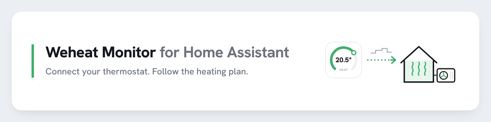
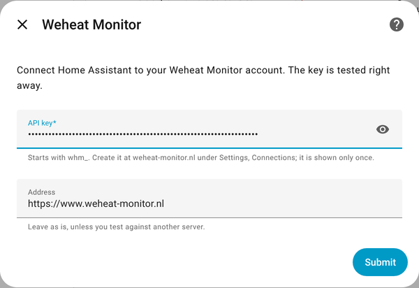
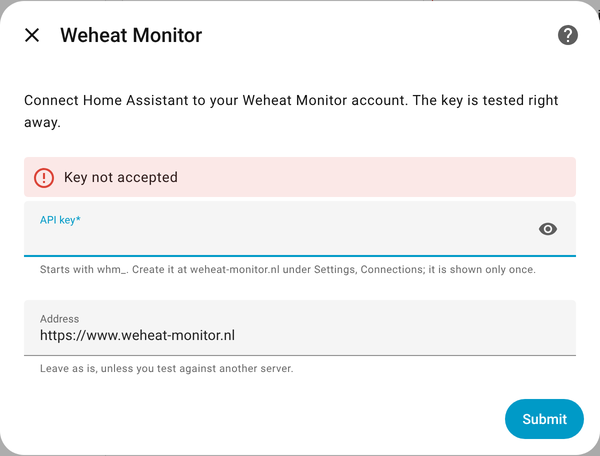
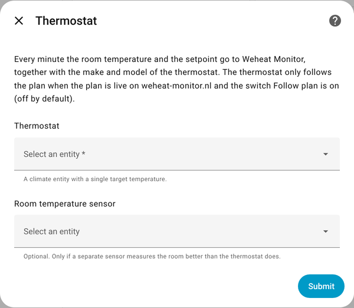

<picture>
  <source media="(prefers-color-scheme: dark)" srcset="docs/readme-banner-dark.png">
  
</picture>

# Weheat Monitor for Home Assistant

Connects your thermostat in Home Assistant to [Weheat Monitor](https://www.weheat-monitor.nl): it sends the room temperature and setpoint every minute, and can let the thermostat follow the heating plan the site makes for your house.

- **Reading**: room temperature and setpoint of one `climate` entity, plus which thermostat it is (make and model).
- **Following the plan** (optional, off by default): the setpoint of the block that applies now goes to the thermostat, always between 12 and 24 °C.
- **Works offline**: measurements wait in a queue for up to 24 hours, and the plan for the next 48 hours is stored locally.
- No extra Python packages. It never talks to Weheat itself, only to weheat-monitor.nl.

> Nederlands: deze integratie koppelt je thermostaat in Home Assistant aan weheat-monitor.nl. Hij stuurt elke minuut de kamertemperatuur en het setpoint, en kan de thermostaat het plan van de site laten volgen. De schermen in Home Assistant zijn ook in het Nederlands.

## Installation

### HACS (custom repository)

1. In Home Assistant open **HACS**, the three dots top right, **Custom repositories**.
2. Repository `https://github.com/kirvis13/weheat-monitor-ha`, type **Integration**, **Add**.
3. Search for **Weheat Monitor** in HACS, **Download**, then restart Home Assistant.

### Manual

Copy `custom_components/weheat_monitor` into the `custom_components` folder of your Home Assistant configuration and restart.

## Setup

1. On [weheat-monitor.nl/settings/connections](https://www.weheat-monitor.nl/settings/connections) create a new connection. Copy the key (`whm_` plus 64 characters); it is shown only once.
2. In Home Assistant: **Settings, Devices & services, Add integration, Weheat Monitor**.

**Step 1, the key.** It is tested right away; a wrong or revoked key is refused on the spot.

| | |
|---|---|
|  |  |

**Step 2, the thermostat.** Pick the `climate` entity of your thermostat. Only if a separate sensor measures the room better than the thermostat does, pick that sensor too.



Change the thermostat or the room sensor later with **Configure** on the integration.

_Screenshots: Home Assistant 2026.2 with the demo integration and a stand-in for the API._

## What is sent

| What | Where it comes from | How often |
|---|---|---|
| Room temperature | The thermostat's current temperature, or the room sensor you picked | Every minute |
| Setpoint | The thermostat's target temperature | Every minute |
| Manual change | `manual: true` on the first measurement after someone changed the setpoint | When it happens |
| Thermostat | Integration (for example `tado`, `nest`, `honeywell`), make, model, temperature step, minimum and maximum, HVAC modes. No name, no entity id | At start-up, after a change, and once a day |

Weheat Monitor uses the room temperature for the night plan and the setpoint to see what the plan did. Make and model let it account for how your thermostat behaves; whether the thermostat drives the heat pump on/off or via OpenTherm it already knows from Weheat. More values (P1 meter, a heat meter such as a Kamstrup) will come once the site does something with them.

## Entities

| Entity | What it shows |
|---|---|
| `sensor.weheat_monitor_last_sync` | Time of the last successful sync. Attributes: `queue_length`, `stored`, `duplicates`, `skipped`, `last_error` |
| `sensor.weheat_monitor_active_setpoint` | Setpoint of the block that applies now (empty without one). Attributes: `plan_id`, `reason`, `start`, `end`, `base_setpoint`, `decision`, `manual_pause_until` |
| `binary_sensor.weheat_monitor_plan_live` | On when the plan is switched live for this connection on weheat-monitor.nl |
| `switch.weheat_monitor_follow_plan` | Your local off switch. **Off by default** |

## How steering works

The thermostat is only written when **both** locks are open: `plan_live` on the site, and **Follow plan** in Home Assistant.

1. The block that applies now (`start <= now < end`) wins; when blocks overlap, the newest (`created_at`) wins.
2. The setpoint is clamped to 12-24 °C, then rounded to the thermostat's own step and limits. Only `temperature` is set, never the HVAC mode.
3. After writing, the `plan_id` is reported back with the next sync (`applied`).
4. No valid block any more (plan ended, plan switched off on the site): back to the base setpoint **once**, then the thermostat is left alone.
5. **The person wins.** When the setpoint changes and the change did not come from this integration (recognised by the Home Assistant context), it does nothing for 4 hours and the next measurement carries `manual: true`. This also applies to the thermostat's own schedule or another automation. A change made while Home Assistant was down is detected at start-up.

## Thermostat test (coming to weheat-monitor.nl)

Every thermostat turns "the room is too cold" into a requested water temperature in its own way, and that decides how long and how low your heat pump runs. Weheat Monitor will be able to measure this for your thermostat in a test of about two days, and show you the result as a profile of your thermostat.

The integration does nothing special for it. The test is a series of ordinary plan blocks (their `reason` starts with `test:`), with the same two locks and rules as any plan: **Follow plan** on in Home Assistant, and the test started by you on the site.

What you notice:

- The setpoint on your thermostat changes every half hour or so, never above 24 °C. Your house does not get warmer: for the test the site asks you to change one setting in the Weheat app, and walks you through changing it back afterwards.
- Changing the setpoint yourself pauses steering for 4 hours, as always. Stopping the test on the site removes the remaining blocks; the thermostat then goes back to the base setpoint once.
- Nothing extra is sent: the test uses the measurements listed under "What is sent".

## Offline and failures

- Every minute one measurement is queued and sent with `POST /api/v1/devices/sync`, at most 100 per call, so a backlog drains in batches.
- When a sync fails (no internet, 429, 5xx) the queue is kept (stored on disk, survives a restart) and retried after 1, 2, 4, 8 and then every 15 minutes. Anything older than 24 hours is dropped, as the server would refuse it.
- After a lost answer the same minutes arrive twice; the server counts them as `duplicates`, which is normal.
- A 401 (key revoked) starts the re-authentication flow: paste a new key.
- The stored plan keeps running without internet until its last block ends; then back to the base setpoint once.

## Privacy

The key goes only into the `Authorization: Bearer` header; it is never logged, and stored only where Home Assistant keeps credentials. Only what is listed under "What is sent" leaves your house, and only to weheat-monitor.nl. Removing the integration also deletes its local queue and plan. Revoke the key on the site to stop everything at once.

## Development

The decision rules (`logic.py`), queue and sync (`engine.py`) and the API client (`api.py`) have no Home Assistant imports and are tested against a stand-in for the API over real HTTP:

```bash
pip install -r requirements_test.txt
pytest -q
```

The tests cover the queue (outage, batches of 100, the 24-hour cap, duplicates), the block choice (overlap, boundaries), the 4-hour rule (and that only the next measurement is flagged), the 12-24 °C limit, and when the thermostat info is sent. CI also runs `hassfest` and the HACS action.

Want to help? See [CONTRIBUTING.md](CONTRIBUTING.md).

## Changes

See [CHANGELOG.md](CHANGELOG.md). Releases are tagged `vX.Y.Z`; HACS offers them as updates.

## License

MIT
